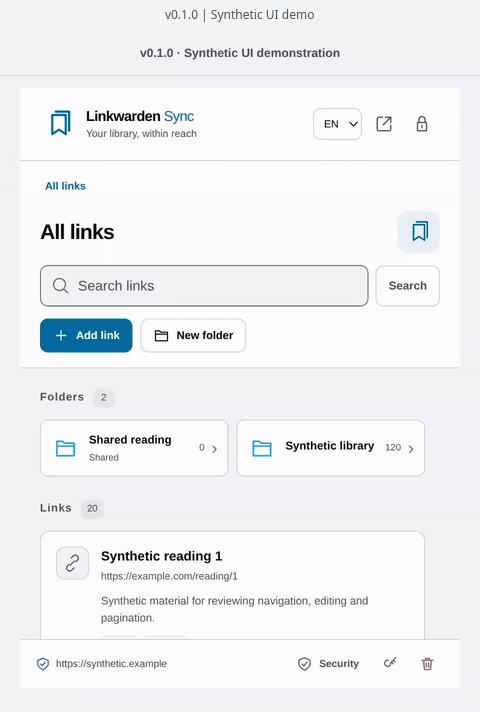
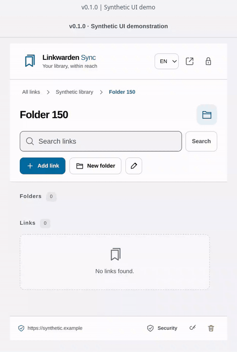

  

# Linkwarden Sync

**Your Linkwarden library, within reach.**

Browse folders, find a saved link, and keep your collections organized from your browser. Linkwarden Sync connects directly to your Linkwarden instance, with password-protected credentials and an interface in English or Portuguese (Portugal).

**Chromium · Firefox · English · Português (Portugal)**

[See it in action](#see-it-in-action) · [Security and privacy](#security-and-privacy) · [Get started](#get-started)

> **Preview — v0.1.0.** Store downloads are not available yet. Live integration with Linkwarden 2.16.3 remains to be validated.

## Your links, organized

- **Navigate folders and subfolders.** Follow breadcrumbs, open nested collections, and scroll through large folder lists inside the popup.
- **Find what you saved.** Search all links or the current collection, and load more results as you go.
- **Save a page where it belongs.** Choose **Add link** in the toolbar popup to fill in the selected tab's URL and title automatically, review its details, and choose a destination before saving.
- **Keep your library tidy.** Edit link details and tags, move or delete links, create or rename collections, and move folders while respecting your account's permissions.
- **Choose your workspace.** Use the compact popup or open a larger library page.
- **Choose your appearance.** Follow your system or select a light or dark theme from the moon icon. The choice is saved only on this device.
- **Use your language.** Switch between English and European Portuguese without saving a language preference on disk.

Links and organizational changes live in your Linkwarden instance. Uploaded-file entries are displayed but edited in Linkwarden. Collection deletion and biometric unlocking are not available in this preview.

## See it in action

### Browse a library with 150 subfolders

*v0.1.0 · UI demonstration with synthetic data: 150 subfolders and 120 links.* [Static screenshot](docs/media/library-navigation.png).

### Save a link in the right folder

*v0.1.0 · Recorded from the running UI with synthetic data.* [Static screenshot](docs/media/save-link.png).

Prefer a darker workspace? Choose **Dark** or **Follow system** from the moon icon. [View the dark theme](docs/media/dark-mode.png).

These recordings use the standalone UI demo with an in-memory data source. They illustrate navigation and editing; no request is sent to Linkwarden, and they do not demonstrate production authentication or live server writes.

## Security and privacy

### Your credentials are encrypted on this device

The extension saves only your **instance URL and API token, encrypted together**, plus the metadata needed to unlock them. Separate, non-secret automatic-lock and appearance preferences are also saved on this device. A separate vault password protects that record. Your vault password is **not saved or sent to Linkwarden**, and unwrapped encryption keys are not persisted.

The vault uses **AES-256-GCM** and password-derived protection with **PBKDF2-HMAC-SHA256, 600,000 iterations**. Use a long, unique vault passphrase: a copied encrypted record can still be attacked offline.

### Your library stays with Linkwarden

The extension does not persist a local copy of your links, folders, searches, forms, or browsing history. While unlocked, the URL/token and expiry markers stay in browser session memory; library content stays in the open interface's memory.

Communication goes directly to the configured instance over **HTTPS**. There is no project-operated intermediary, telemetry, analytics, advertising, or automatic request to third-party fonts, favicons, or preview services. Opening a bookmark visits its destination under the browser's usual rules.

### You control access

| Control | What it means for you |
| --- | --- |
| **Password unlocking** | After a complete browser restart, unlock the saved connection with your vault password instead of copying the token again. |
| **Automatic locking** | Enabled by default: 5 minutes of inactivity or 30 minutes in total. In **Security**, you can explicitly select **Until the browser closes** to disable both time limits. Real interaction renews idle expiry at most once per 30 seconds in the default mode. |
| **Manual lock** | Discard the unlocked session and clear private content from open extension views. |
| **Forget vault** | Remove the encrypted connection, unlocked session, saved lock and theme preferences, and granted instance permissions from the extension. |
| **Explicit page capture** | The current page's URL and title are read when you choose **Add link** in the toolbar popup. |
| **Instance permission** | Access is requested for the chosen server when you connect; installing does not grant access to every HTTPS site. |

The browser-lifetime option keeps credentials available in session memory for longer; use it only on a trusted device. The choice is remembered, but never unlocks a restarted browser automatically. Manual lock, rejected authentication, lost permissions, update/disablement and lost session memory still require unlocking. Switching back to inactivity locking starts fresh timeout limits.

Closing the popup clears its view and forms; a valid unlocked session may remain until it expires. Closing all windows may leave a browser process running. Browser scheduling can delay cleanup, so expiry is also checked before credentials are used.

Firefox declares authentication and browsing-activity data because the integration sends your API token and selected URLs to your instance. The [privacy policy](PRIVACY.md) describes those transfers.

Ordinary locking retains the host permission. Firefox's host grant covers HTTPS on that host across ports, while requests stay bound to your configured URL. The instance domain can still appear in browser permissions, DNS, network traffic, and external logs.

### Know the limits

Use a **long, unique vault passphrase** and a dedicated, preferably time-limited Linkwarden token. Tokens may carry broad account permissions. A copied encrypted vault can be attacked offline; encryption cannot protect an unlocked session from malware, administrator or debugging access, a compromised browser, or all powerful network/proxy extensions. Physical memory erasure, removal from backups, and concealment of the instance domain cannot be guaranteed.

Review the URL and destination before saving, especially for shared collections. Linkwarden may fetch and archive submitted destinations. Changing a URL can delete its existing archives. Avoid simultaneous edits in different clients: the API has no atomic conflict protection. If a write result is uncertain, check the server before repeating it; the extension does not retry writes automatically.

Forgetting or uninstalling the extension does not revoke its token or delete server data. Revoke a compromised token in Linkwarden. If you lose the vault password, configure the connection again with a valid token; there is no password-recovery bypass.

Read the [privacy policy](PRIVACY.md) and [security reporting policy](SECURITY.md). This preview has received code review and automated checks; it has not received an independent security audit.

## Get started

**Minimum API target: Linkwarden 2.16.3 over HTTPS.** Later versions require compatibility validation. HTTP connections are rejected, including localhost; private instances need a certificate trusted by your browser.

The configured browser minimums are Chromium 140+ and Firefox 140+. Local checks have covered Chromium 155 and Firefox 158 on Linux; this does not establish compatibility with every browser version or operating system.

Chrome Web Store and Firefox Add-ons downloads are not available yet. To try the preview, follow the [installation guide](docs/GETTING_STARTED.md).

1. Create a dedicated API token in your Linkwarden settings.
2. Enter your server URL and token, then choose a separate vault password of at least 12 characters. The extension does not request your Linkwarden account password.
3. Confirm the server, choose **Allow access and connect**, and grant its browser permission.
4. Browse your library and review each destination before saving a link.

## Project information

Linkwarden Sync is an independent project. It is not an official Linkwarden extension.

- [Installation and usage](docs/GETTING_STARTED.md)
- [Privacy](PRIVACY.md) · [Report a security issue](SECURITY.md)
- [Publishing to Chrome and Firefox stores](docs/PUBLISHING.md)

Never include tokens, passwords, vault files, browser profiles, or a private library in public issues or recordings. The private reporting channel and public support contacts are not yet configured; see [SECURITY.md](SECURITY.md) before reporting sensitive information.

## License

Copyright (C) 2026 Linkwarden Sync contributors.

This project is licensed under the **GNU General Public License, version 3 or any later version** (`GPL-3.0-or-later`). See [LICENSE](LICENSE) for the full terms. Third-party dependencies retain their own licenses and notices; bundled runtime notices are included in [THIRD_PARTY_NOTICES.txt](THIRD_PARTY_NOTICES.txt).
